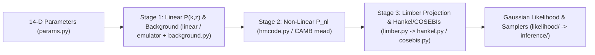

# kidspipe

A pure-Python (`NumPy` + `SciPy` + `Numba` + `CAMB`) implementation of the KiDS KV450 cosmic-shear inference pipeline, extended to COSEBIs, official KiDS-Legacy validation, and a resumable DR5 shear-catalogue measurement chain — with no CosmoSIS dependency and optional MPI.

> **`v0.2.0`** · Python `3.10–3.13` · NumPy `1.26 / 2.x` · CAMB `1.5.8 / 2.x` · Numba JIT (`0.59–0.68`) · Track **B1–B5** Optimised

---

## Capabilities

- **KV450 Cosmic-Shear Inference:** Full 14-parameter forward model (`omch2`, `ombh2`, `h`, `n_s`, `ln_1e10_A_s`, `A_baryon`, `A_IA`, `delta_c`, `A_c`, `dz1..dz5`) to the 195-point $\xi_\pm$ Gaussian likelihood, with MAP + Hessian, blocked Metropolis MCMC, affine-invariant ensemble sampling, and nested sampling (`dynesty` / `nautilus`).
- **COSEBIs ($E_n$):** 5- and 20-mode COSEBIs validated against staged KV450 data ([docs/COSEBIS.md](docs/COSEBIS.md)).
- **KiDS-Legacy Validation:** End-to-end `kidspipe.legacy` COSEBIs verification against the official KiDS-Legacy release ([docs/KIDS_LEGACY_VALIDATION.md](docs/KIDS_LEGACY_VALIDATION.md)).
- **DR5 Shear-Catalogue Measurement:** Resumable FITS extraction, TreeCorr $\xi_\pm$ across 6 tomographic bins (21 pairs) with bounding-cap chunk pruning and `mmap` streaming, COSEBIs transformation, and official-product crosschecks ([docs/DR5_MEASUREMENT_REPORT.md](docs/DR5_MEASUREMENT_REPORT.md)).

---

## Pipeline Architecture

The forward model is organised into three cached stages (so MCMC parameter blocks only recompute invalidated downstream work) plus a unified **vectorised batch path** (`mu_batch` / `log_like_batch`) that deduplicates repeated `(omch2, ombh2, h)` cosmologies:



| Module | Responsibility |
|---|---|
| [`src/kidspipe/params.py`](src/kidspipe/params.py) | Parameter names, bounds, flat + truncated-Gaussian priors, scalar & vectorised `prior_transform` / `in_bounds` |
| [`src/kidspipe/theory/background.py`](src/kidspipe/theory/background.py) | Stand-alone Numba flat-$\Lambda$CDM background solver `compute_background` ($E(z)$, $\chi(z)$, $\Omega_m$, $\omega_{\nu}$ for $m_\nu = 0.06\,\mathrm{eV}$) |
| [`src/kidspipe/theory/linear.py`](src/kidspipe/theory/linear.py) | CAMB wrapper with LRU cache on `(omch2, ombh2, h)` and exact $A_s / n_s$ rescaling |
| [`src/kidspipe/theory/emulator.py`](src/kidspipe/theory/emulator.py) | Optional PCA + poly/GP transfer emulator (`linear_backend="emulator"`), cached Hermite `_Sigma8Operator`, default Numba background, batched `predict_batch` / `compute_batch`, exact-CAMB fallback |
| [`src/kidspipe/theory/hmcode.py`](src/kidspipe/theory/hmcode.py) | Stand-alone Numba HMcode-2016 `P_nl(k, z)` (`hmcode_pnl`, `hmcode_pnl_batch`; 8-accumulator deterministic `_dot`, pre-split `_fg_tab`, hoisted halo loop, low-$k$ skip) |
| [`src/kidspipe/theory/nonlinear.py`](src/kidspipe/theory/nonlinear.py) | Non-linear dispatcher (`hmcode` or CAMB `mead`), batched `get_pnl_batch`, high-$k$ extension |
| [`src/kidspipe/theory/nz.py`](src/kidspipe/theory/nz.py) | KV450 tomographic $n(z)$ and photo-$z$ shift helpers |
| [`src/kidspipe/theory/limber.py`](src/kidspipe/theory/limber.py) | Lensing kernels, NLA intrinsic alignments, 15-pair Limber $C_\ell$: zero-allocation pre-indexed `_fill_q` with AVX2 1-ulp `_vexp1`, lazy cubic stencils, refcount-guarded `Qt` pool, LRU caches, batched `limber_cl_batch` |
| [`src/kidspipe/theory/hankel.py`](src/kidspipe/theory/hankel.py) | $C_\ell \to \xi_\pm$ & angular binning (`fast` exact bin-averaged operator or `kcap` FFT + trapezoid, scalar & batch) |
| [`src/kidspipe/theory/cosebis.py`](src/kidspipe/theory/cosebis.py) | COSEBIs $E_n$ filter functions and binned-$\xi_\pm$ projection |
| [`src/kidspipe/theory/model.py`](src/kidspipe/theory/model.py) | `CosmicShearModel`: staged cache for `mu(theta)` and end-to-end batched `mu_batch(thetas)` |
| [`src/kidspipe/likelihood/`](src/kidspipe/likelihood) | Data vector, cut covariance, $c$-term & $m$-bias corrections, Cholesky $\chi^2$, scalar `log_like` & batched `log_like_batch` |
| [`src/kidspipe/inference/`](src/kidspipe/inference) | `Posterior` (`log_like_batch`, `log_post_batch`), MAP + Hessian, blocked Metropolis / ensemble MCMC, `dynesty` / `nautilus` (`vectorized=True`) |
| [`src/kidspipe/measure/`](src/kidspipe/measure) | DR5 catalogue `load_bin` (supports column-selective `.npz` & `mmap`), TreeCorr runner, COSEBIs estimators |
| [`src/kidspipe/legacy/`](src/kidspipe/legacy) | KiDS-Legacy COSEBIs validation pipeline |
| [`src/kidspipe/api.py`](src/kidspipe/api.py) | High-level builders (`build_model`, `build_likelihood`, `build_posterior`), presets, derived parameters |
| [`src/kidspipe/cli.py`](src/kidspipe/cli.py) / [`paths.py`](src/kidspipe/paths.py) | `kidspipe` CLI entrypoint and environment-overridable path resolution |

---

## Quick Start

### 1. Installation

```bash
git clone <your-private-repo-url> kidspipe && cd kidspipe
python3 -m venv .venv && source .venv/bin/activate     # optional
pip install -e '.[all]'          # core + samplers + measure (treecorr, fitsio) + plots + emulator retraining + pytest
kidspipe check                   # self-test (~7 s after Numba cache warmup)
pytest -q -m "not slow"          # fast test suite
```

Extras defined in [`pyproject.toml`](pyproject.toml): `samplers` (`dynesty`, `nautilus-sampler`, `h5py`), `measure` (`treecorr`, `fitsio`), `plots` (`matplotlib`), `emulator` (`joblib`), `mpi` (`mpi4py`, `threadpoolctl`), `test` (`pytest`), and `all`. Plain `pip install -e .` installs only the core stack (`numpy`, `scipy`, `numba`, `camb`, `astropy`, `mpmath`). Without installing, set `export PYTHONPATH=$PWD/src` and use `python3 -m kidspipe`.

**Thread control:** Numba ignores `OMP_NUM_THREADS`. The `kidspipe` CLI sets thread limits automatically; when calling the Python API directly, export:
```bash
export OMP_NUM_THREADS=4 NUMBA_NUM_THREADS=4 OPENBLAS_NUM_THREADS=1
```

### 2. CLI Commands

```bash
kidspipe loglike                                                   # chi2, ln L, ln post, and S8 at spec test cosmology
kidspipe map --starts 2 --maxiter 40 --rounds 1 --polish none      # MAP + Hessian -> $KIDSPIPE_RUNS/map/map.json
kidspipe mcmc --chains 4 --workers 4 --worker-threads 4 --burn 300 --cycles 700
kidspipe nested --sampler nautilus --workers 20
kidspipe bench                                                     # per-parameter and per-stage cost breakdown
```

See [docs/USAGE.md](docs/USAGE.md) for the complete CLI reference.

### 3. Python API (Scalar & Vectorised Batch)

```python
import numpy as np
from kidspipe import api, params
from kidspipe.inference.nested import make_nested_functions

# Scalar evaluation (default CAMB backend)
post = api.build_posterior()
th = api.preset("test")
print(-2 * post.log_like(th))            # 196.10
print(api.derived_for(post, th))         # {'sigma8': 0.709092, 'omega_m': 0.250296, 'S8': 0.647692}

# Batched evaluation with transfer emulator + Numba background + HMcode
emu_post = api.build_posterior(api.build_model(linear_backend="emulator"))
thetas = params.prior_transform(np.random.default_rng(0).uniform(size=(64, 14)))
ll_batch = emu_post.log_like_batch(thetas)

# Wire vectorised likelihood & prior transform for nautilus / dynesty
ll_fn, pt_fn, ndim = make_nested_functions(emu_post, vectorized=True)
```

For in-process batched nested sampling with `nautilus`, run [`scripts/run_kv450_nested.py`](scripts/run_kv450_nested.py) with `--vectorized`.

### 4. DR5 Measurement Fast Path

```bash
# Optional: unpack bin*.npz into read-only uncompressed column arrays for mmap streaming
python3 scripts/dr5_extract.py --from-npz --uncompressed-dir /path/to/uncompressed --bins 1,2,3,4,5,6

# Bounding-cap chunk pruning is enabled by default (--prune / --no-prune); add --mmap for low RSS
python3 scripts/dr5_measure_xi_chunked.py --mmap --bins 1,2,3,4,5,6 --threads 16
```

Or run the full resumable chain end-to-end via [`scripts/dr5_chain.py`](scripts/dr5_chain.py) (see [scripts/README.md](scripts/README.md)).

---

## Performance & Optimisations (Track B1–B5)

### Merged Efficiency Patches on Current `main`

| Patch | Component & What Changed | Measured Speedup & Numerical Equivalence |
|---|---|---|
| **B1** | **HMcode 1-halo inner loop** (`theory/hmcode.py`): 8-accumulator deterministic `_dot`, pre-split `_fg_tab` table coordinates, hoisted halo invariants, provable low-$k$ skip | ~1.9x faster HMcode 1-halo loop; `|dP/P| < 5e-14`; bit-identical across Numba thread counts |
| **B2** | **Limber zero-allocation `_fill_q`** (`theory/limber.py`): pre-indexed specialised kernels, AVX2 1-ulp `_vexp1`, reverse `lb` scan, lazy cubic stencils, refcount-guarded `Qt` buffer pool, thread-safe LRU caches | `1.74–1.94x` faster `limber_power` (`2.14–2.67x` warm `set_power` at 4t); constant per-call NRT allocations; `< 1.3e-14` rel diff on `Q` with identical zero masks |
| **B3** | **Numba background & Hermite $\sigma_8$** (`theory/background.py`, `theory/emulator.py`): stand-alone Numba background solver (`background_backend="numba"` default at $m_\nu = 0.06\,\mathrm{eV}$; `"camb"` fallback) and cached cubic Hermite `_Sigma8Operator` | Cuts emulator background from ~1.2 ms (CAMB) to ~0.06 ms and removes the 16-thread scaling regression; `|Delta chi2| < 1e-4` vs CAMB background |
| **B4** | **DR5 chunk pruning & `mmap`** (`measure/xi.py`, `scripts/dr5_extract.py`, `scripts/dr5_measure_xi_chunked.py`): spherical bounding-cap pruning (`--prune`), uncompressed `.npy` export, column-streaming `--mmap`, ref-counted `GField` cache release | Conservatively prunes `3,234 / 4,656` (`69.5%`) analytically zero chunk pairs (`0` false positives across all 21 pairs); bitwise identical TreeCorr arrays at 1 thread |
| **B5** | **Vectorised batch pipeline** (`model.py`, `hmcode.py`, `emulator.py`, `limber.py`, `hankel.py`, `gauss.py`, `posterior.py`, `nested.py`): batch deduplication on `(omch2, ombh2, h)`, unified `hmcode_pnl_batch` (with B1) and `compute_batch` (with B3), vectorised `dynesty` / `nautilus` | Cold uncached Config `iii` (`M=64`): `1.89x` throughput speedup at 16t (`20.72` vs `10.94 eval/s`; `1.22x` at 8t); scalar `log_like` parity `<= 1.2e-15` rel (`mu` within `rtol <= 1e-13` away from `J_0` zero-crossings / `<= 7.6e-19` abs) |

### Cached Move Hierarchy (Pre-Optimisation Baseline Reference)

Before Track B1–B5, quiet-workstation medians at 4 threads (`runs/bench_t4.json`, `benchmarks/bench_pipeline.py`, CAMB 1.5.8; see [docs/PERFORMANCE.md](docs/PERFORMANCE.md)) established the baseline block cost structure:

| Block | Parameters Varied | Recomputed Stages | Baseline CAMB (4t) | Baseline Emulator (4t) |
|---|---|---|---|---|
| `slow` | `omch2`, `ombh2`, `h` (+ joint `n_s`, `A_s`, `A_baryon`) | Transfer function / emulator + all downstream stages | `0.58 s` | `35 ms` |
| `medium` | `n_s`, `ln_1e10_A_s`, `A_baryon` | Exact $P_{\mathrm{lin}}$ rescale, new HMcode $P_{\mathrm{nl}}$, Limber power table | `26 ms` | `26 ms` |
| `fast` | `A_IA`, `A_c`, `delta_c`, `dz1..dz5` | $C_\ell$ projection, Hankel binning, likelihood | `1.1 ms` | `1.2 ms` |

---

## Scientific Validation Summary

All core numbers come from the repository's self-test and validation suite (`docs/MASTER_MATH_SPEC.md`, `tests/test_e2e.py`, and report docs):

| Check | Result |
|---|---|
| Test cosmology $\chi^2$ (`A_baryon = 2`) | `196.104` (`hmcode` + `fast`), `196.091` (`camb` + `fast`), `196.075` (`kcap` fidelity); spec anchor `196.06` |
| Derived quantities at test cosmology | $\sigma_8 = 0.709092$, $\Omega_m = 0.250296$, $S_8 = 0.647692$ (matches spec identically) |
| `hmcode` vs CAMB `mead` (8 pts, $\chi^2 \in [189, 236]$) | `max |Delta chi2| = 0.09` (typically `0.01`) |
| `fast` vs `kcap` fidelity | Median difference `0.2%` (`0.7%` max in largest $\xi_+$ bin); `|Delta chi2| = 0.03–0.04` near best fit (`<= 0.56` on amplitude scan vs `<= 0.08` for `kcap`) |
| Transfer emulator vs exact CAMB (30 new points) | `max |Delta chi2| = 0.004` (`P_lin` error `<= 1.3e-3` vs dense truth for $k < 10\,h/\mathrm{Mpc}$, $z \le 3$); bitwise identical CAMB fallback outside the training box |
| Indicative KV450 4-chain MCMC sanity check | $S_8 = 0.734 \pm 0.037$ (R-hat `1.005` on $S_8$; Hildebrandt et al. 2020 *external* mean `0.737 +0.040/-0.036`; nuisance/degeneracy directions not fully converged — see [docs/RESULTS.md](docs/RESULTS.md)) |

---

## Google Colab & Notebooks

The repository clones and runs directly on Google Colab with persistent outputs on Google Drive (`KIDSPIPE_RUNS`, `KIDSPIPE_DR5_WORK`); see [docs/COLAB.md](docs/COLAB.md).

| Notebook | Purpose |
|---|---|
| [`notebooks/00_setup_and_tests.ipynb`](notebooks/00_setup_and_tests.ipynb) | Clone repo, install extras, mount Google Drive, run `kidspipe check` and `pytest -m 'not slow'` |
| [`notebooks/01_kv450_inference.ipynb`](notebooks/01_kv450_inference.ipynb) | KV450 $\xi_\pm$ likelihood, MAP, MCMC, and Colab-sized nested sampling |
| [`notebooks/02_cosebis_and_legacy.ipynb`](notebooks/02_cosebis_and_legacy.ipynb) | COSEBIs validation and KiDS-Legacy comparison |
| [`notebooks/03_dr5_measurement.ipynb`](notebooks/03_dr5_measurement.ipynb) | Download DR5 shear catalogue, extract bins, and run resumable measurement chain on Drive |
| [`notebooks/04_dr5_exact_colab_cli.ipynb`](notebooks/04_dr5_exact_colab_cli.ipynb) | Option-B Colab CLI clone notebook for resumable DR5 exact ($\mathrm{bin\_slop} = 0$) continuation |

---

## Configuration & Testing

### Environment Variables (`src/kidspipe/paths.py`)

| Variable | Purpose | Default |
|---|---|---|
| `KIDSPIPE_ROOT` | Repository root | Checkout root |
| `KIDSPIPE_DATA` | Shipped data (`data/`, ~64 MB) | `<root>/data` |
| `KIDSPIPE_RUNS` | Run outputs (falls back to shipped `runs/` for reads) | `<root>/runs` |
| `KIDSPIPE_OFFICIAL` | Official KiDS-Legacy release files | `<data>/kids_legacy` |
| `KIDSPIPE_DR5_WORK` | Per-bin DR5 extracts (`bin0..5.npz`, ~1.6 GB) | `~/kids_dr5_work` |
| `KIDSPIPE_DR5_CATALOGUE` | Public DR5 shear catalogue (`16.4 GB` FITS) | `<dr5_work>/KiDS_Legacy_NS_unblind_final.fits` |
| `KIDSPIPE_EMULATOR` | Transfer-emulator artefact | Auto-selected via `emulator_artefact()`: `transfer_emulator_v1.npz` (CAMB 1.x) or `transfer_emulator_v1_camb2.npz` (CAMB 2.x) |
| `KIDSPIPE_PLOTS` | Output directory for plotting scripts | `<root>/plots` |

### Test Suite

```bash
pytest -q -m "not slow"
```

- [`tests/test_e2e.py`](tests/test_e2e.py): spec anchors, staged-cache exactness, fidelity/backend equivalence, and CLI checks. *(Note: CLI tests in `test_e2e.py` require Python >= 3.12 due to nested f-string quotes at `cli.py:601`.)*
- [`tests/test_batch_vectorized.py`](tests/test_batch_vectorized.py): end-to-end vectorised batch parity (`mu_batch`, `log_like_batch`, `hmcode_pnl_batch`, nested wiring).
- Markers: `slow` (CLI/pool smoke tests) and `timing` (wall-clock gates enabled automatically on $\ge 16$ cores or with `KIDSPIPE_TIMING_TESTS=1`; `0` disables). Tests requiring `treecorr` or `nautilus` skip when those optional extras are absent.

---

## Documentation Guide

| Document | Contents |
|---|---|
| [docs/USAGE.md](docs/USAGE.md) | CLI commands (`check`, `loglike`, `map`, `mcmc`, `nested`, `bench`), MPI, Python API |
| [docs/COMPATIBILITY.md](docs/COMPATIBILITY.md) & [docs/COLAB.md](docs/COLAB.md) | Supported Python / CAMB / NumPy versions and Colab workflow |
| [docs/RESULTS.md](docs/RESULTS.md) | KV450 $\xi_\pm$ MAP, blocked MCMC, nested sampling, and sensitivity analysis |
| [docs/COSEBIS.md](docs/COSEBIS.md) & [docs/KIDS_LEGACY_VALIDATION.md](docs/KIDS_LEGACY_VALIDATION.md) | COSEBIs validation and official KiDS-Legacy crosschecks |
| [docs/DR5_MEASUREMENT_REPORT.md](docs/DR5_MEASUREMENT_REPORT.md) | DR5 extraction, TreeCorr $\xi_\pm$, COSEBIs, and verification gates |
| [docs/PERFORMANCE.md](docs/PERFORMANCE.md) | Baseline benchmarks, stage breakdowns, thread scaling, and accuracy budgets |
| [docs/DESIGN.md](docs/DESIGN.md), [docs/MASTER_MATH_SPEC.md](docs/MASTER_MATH_SPEC.md), [`docs/interface_notes/`](docs/interface_notes) | Software architecture, mathematical specification, and interface decisions |
| [data/README.md](data/README.md) & [scripts/README.md](scripts/README.md) | Shipped data inventory and driver script execution order |

---

## Scope & Key Caveats

- **Emulator scope:** Covers `omch2` $\in [0.03, 0.34]$, `ombh2` $\in [0.019, 0.026]$, `h` $\in [0.64, 0.82]$ (`32%` of the KV450 prior volume) at fixed $m_\nu = 0.06\,\mathrm{eV}$. Available through the Python API and [`scripts/run_kv450_nested.py`](scripts/run_kv450_nested.py) (not exposed via `kidspipe` CLI flags); requests outside the box fall back cleanly to exact CAMB. An emulator-vs-CAMB full posterior chain comparison has not been run.
- **`fast` vs `kcap` convention:** Default `fast` exact angular bin averaging shifts $\chi^2$ by `~0.03–0.04` near the best fit relative to `kcap` node-trapezoid binning; pass `--fidelity kcap` / `fidelity="kcap"` when matching legacy reference anchors closely.
- **Cosmology & pipeline scope:** Flat $\Lambda$CDM ($w = -1$, $m_\nu = 0.06\,\mathrm{eV}$), HMcode-2016 baryons; band powers, 3x2pt, KiDS-1000 inference, and Hartlap/covariance-determinant terms are outside scope.
- **Unshipped external files:** The 16.4 GB DR5 FITS catalogue must be downloaded from KiDS, and `reference/kcap` is not redistributed.

---

## Data Sources, Licence Notice & Acknowledgements

| Data | Source | Destination |
|---|---|---|
| KV450 data vector, covariance, $n(z)$, $c$-term; COSEBIs tables | Public KiDS KV450 data ([data/README.md](data/README.md)) | Shipped in [`data/kv450/`](data/kv450) & [`data/cosebis/`](data/cosebis) |
| KiDS-Legacy release subset (~26 MB of 131 MB archive) | [KiDS-Legacy release](https://kids.strw.leidenuniv.nl/sci_data/KiDS_Legacy_cosmic_shear_data_release.tar.gz) | Shipped in [`data/kids_legacy/`](data/kids_legacy) |
| **DR5 shear catalogue** (`KiDS_Legacy_NS_unblind_final.fits`, 7.2 GB `.gz` / 16.4 GB) | [KiDS DR5 download page](https://kids.strw.leidenuniv.nl/DR5/legacy_wl.php) | Downloaded to `$KIDSPIPE_DR5_CATALOGUE` (**not shipped**) |
| Linear-transfer emulators (`v1` & `v1_camb2`) | Generated by [`scripts/train_emulator.py`](scripts/train_emulator.py) | Shipped in [`data/emulator/`](data/emulator) |

### Data and Third-Party Notice

This repository is private and carries no open-source licence file for redistribution. The KiDS / KV450 / KiDS-Legacy products under [`data/`](data/) and [`runs/`](runs/) belong to the KiDS collaboration and remain governed by the KiDS data terms (`data/kids_legacy/RELEASE_README.txt`). Third-party packages installed from PyPI (`camb`, `treecorr`, `numpy`, `scipy`, `numba`, `dynesty`, `nautilus-sampler`, etc.) carry their respective licences; KiDS `kcap` is not included. Original source code, scripts, tests, benchmarks, documentation, and emulator artefacts (`transfer_emulator_v1.npz` and `transfer_emulator_v1_camb2.npz`) belong to this project.

### Acknowledging KiDS

If you use KiDS-Legacy / DR5 data or derived results, acknowledge KiDS and cite **Wright et al. 2024 (A&A 686, A170)** together with the KiDS-Legacy papers listed in [`data/kids_legacy/RELEASE_README.txt`](data/kids_legacy/RELEASE_README.txt) and include:
> *"Based on observations made with ESO Telescopes at the La Silla Paranal Observatory under programme IDs 179.A-2004, 177.A-3016, 177.A-3017, 177.A-3018, 298.A-5015."*

For KV450 data cite **Hildebrandt et al. 2020 (A&A 633, A69)**.

---

## Development & Contributors

Maintained by `SangkaAnut`. Implementation, optimisation, verification, and documentation in this repository were developed with AI coding assistants recorded across the git history:

- **Claude:** Baseline KV450, COSEBIs, KiDS-Legacy, and DR5 pipeline, CAMB 2 / NumPy 2 compatibility, emulator artefacts, and the initial Limber `_fill_q` kernel restructure (`bf9f2cf`).
- **Hermes Agent:** Track B1 HMcode 1-halo inner-loop optimisation (`588df04`).
- **Gemini (Google Antigravity):** Track B2–B5 optimisations (Limber `_fill_q` v2 kernels/caches/`Qt` buffer pool, Numba background solver & Hermite $\sigma_8$ operator, DR5 bounding-cap pruning & `mmap` loading, end-to-end vectorised batch evaluation & nested-sampler wiring), Track B integration onto `main`, and documentation updates.
